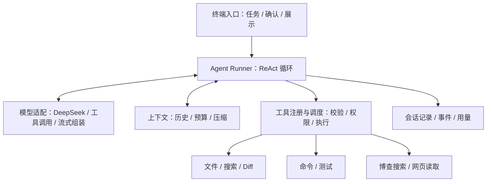

# Mini Coding Agent：面向实习展示的项目计划

制定日期：2026-10-18。

实施状态（2026-10-18）：第一阶段离线最小闭环已实现并验收，42 个测试通过；真实模型联调待本地配置 Key。当前能力和本轮设计细化见 [进度记录](docs/progress.md)。以下为完整首版路线，尚未实现的后续功能不代表当前已具备。

## 1. 项目目标与已确认的选择

用 Python 自己实现一个单智能体 Coding Agent，在本地终端完成“理解任务 → 搜索与读取代码 → 修改文件 → 执行测试 → 根据结果修复 → 汇报改动”的完整闭环。项目同时服务于功能展示、原理学习和面试复盘。

| 项目 | 已确认的选择 |
| --- | --- |
| 目标岗位 | 以 Agent 应用开发实习为准备方向 |
| 项目位置 | `D:\大模型课程\大模型学习指导\旅游规划项目agent demo`，以最后提供的明确路径为准 |
| 技术限制 | Python；不用 LangChain，不引入代替自己完成 Agent 编排的框架 |
| Agent 形式 | 单 Agent，自己实现 ReAct 决策与工具反馈循环 |
| 首版入口 | 终端交互，内核可被未来的 Web 或桌面入口复用 |
| 模型基准 | DeepSeek 官方兼容接口，地址与模型名可配置 |
| 验收对象 | 小型 Python 仓库；工具设计保留处理其他文本代码的通用性 |
| 联网 | 博查搜索 API，加自行实现的网页正文读取工具 |
| 默认权限 | 工作目录内自动读写；每次执行命令前人工确认 |
| 学习方式 | AI 分阶段实现，用户运行、读代码、验证理解后进入下一阶段 |
| 时间和预算 | 四周为目标，按阶段验收；模型与搜索 API 合计预算不超过 100 元 |

首版包含多轮交互、代码搜索、文件创建与局部编辑、命令和测试执行、错误反馈修复、修改预览、流式显示、会话保存恢复、上下文压缩、联网查文档、运行统计。

首版不安排多 Agent、向量数据库、代码语义索引、MCP、Skills 加载、模型训练、浏览器自动化和前端页面。后续扩展先考虑 Web；桌面包装为可选项。

展示目标是让面试官能看到真实修改、验证结果和可复现的工程取舍；项目本身不作为获得实习的保证。

## 2. 架构与核心接口

采用单进程、分模块的结构。终端处理输入和展示，内核负责 Agent 行为，工具负责与环境交互。

### 技术选择

- Python 3.12 虚拟环境，使用当前已安装的解释器；通过 `uv` 管理依赖和锁文件，避免默认 `python` 与其他解释器混用。
- 模型通信使用 `openai` Python SDK；只使用其请求与流式能力，Agent 编排自己实现。
- 初始配置采用 `https://api.deepseek.com`、`deepseek-flash`、非 thinking 模式和 `temperature=0`，便于先聚焦工具闭环；模型别名以实施时官方接口实际可用情况验证，配置与响应标识进入评测记录。
- Pydantic 负责参数与配置校验，Rich 负责终端显示，命令入口使用标准库 argparse。
- httpx 负责搜索和网页请求，BeautifulSoup 提取 HTML 正文并保留代码块，pathspec 处理忽略规则。
- pytest、pytest-asyncio 负责验证；Ruff 负责检查与格式化。HTTP 测试使用模拟传输，日常测试不访问真实收费接口。
- 用 JSONL 保存运行事件与完整历史，用原子替换的 JSON 检查点保存可恢复会话；首版不引入数据库。

### 模块职责

| 模块组 | 职责与边界 |
| --- | --- |
| CLI | 收集任务、确认命令、显示文本和工具结果；处理 `/help`、`/diff`、`/compact`、`/stats`、`/exit` |
| Runner | 管理循环、停止条件、取消和错误反馈；不直接调用终端输入函数 |
| Model | 构造兼容请求、解析响应、组装流式工具参数、归一化用量；隔离厂商差异 |
| Tools | 注册工具 schema，校验参数与权限，执行工具，返回统一结果 |
| Context | 组装请求历史、控制输入规模、生成和验证摘要；不修改原始记录 |
| Session / Events | 保存消息、工具执行事件、用量与压缩检查点，支持追溯和恢复 |

### 最小稳定接口

- `ModelClient.stream(request) -> AsyncIterator[ModelEvent]`：提供文本增量和一个完整的模型轮次结果。初期非流式请求也封装成同样的完整结果事件，后续补流式不会改动 Runner 接口。
- `Tool.execute(args, context) -> ToolResult`：输入经过 Pydantic 校验；结果统一表达成功、数据、错误与是否截断。
- `Agent.run(task, session_id) -> AsyncIterator[AgentEvent]`：输出文本、工具开始/结束、权限请求、用量、压缩、错误、结束等事件。
- `ApprovalPort.confirm(request) -> bool`：由终端适配器完成确认；核心代码不依赖 `input()`，以后可替换成 Web 确认界面。
- 内部统一消息类型包含 `Message`、`ToolCall`、`ToolResult`、`Usage`、`AgentEvent`；SDK 对象不直接传遍其他模块。

内核使用 asyncio 组织模型请求、命令超时和取消；单个会话内的工具按顺序执行，便于学习、复现和处理文件依赖。

### 一次完整任务如何运行

1. 终端接收需求，加载会话和用户明确指定的工作目录。
2. Context 组合系统规则、任务约束、摘要和最近消息，检查输入预算。
3. 模型返回普通回复或原生 `tool_calls`。完整接收、解析并校验参数后，才允许执行工具。
4. 调度器检查工具名称、参数、路径与命令确认；按顺序执行本轮调用。
5. 将实际工具结果按 `tool_call_id` 回填，并记录事件、退出码、耗时和用量。
6. 模型依据结果继续读取、修改或修复，直到正常回复结束，或触发步数、预算、错误、取消限制。
7. 汇报改动和实际执行过的验证；明确区分验证通过、验证失败和未验证。

这里的 ReAct 是模型决策、行动、观察反馈的循环，不要求模型输出完整思维链。终端展示必要的行动说明、调用参数和真实结果即可。

## 3. 首版的关键行为

### 编程与联网工具

| 工具 | 关键行为 |
| --- | --- |
| `list_files` / `search_code` | 按路径和内容定位代码，遵守忽略规则；结果带路径、行号和数量限制 |
| `read_file` | 按行读取文本，避免一次装入整个仓库；拒绝二进制文件 |
| `write_file` | 创建新文件；覆盖已有文件前要求先读取，保存修改前内容以便查看差异 |
| `edit_file` | 精确替换并校验匹配数量；零匹配或多匹配时报错，提示重新读取，不猜测修改位置 |
| `run_command` | 展示参数与工作目录，确认后执行；返回退出码、stdout、stderr、耗时和超时状态 |
| `git_diff` | 展示已有 Git 仓库的修改；非 Git 目录展示本会话保存的修改前后差异 |
| `web_search` | 经博查返回标题、URL、摘要；默认最多 5 条，不自动扫描整站 |
| `fetch_url` | 读取公开 HTTP/HTTPS 网页或 Markdown，返回最终 URL 和正文，保留示例代码 |
| `read_output` | 根据输出 ID 分段读取被截断的命令或网页结果，避免反复执行原操作 |

写文件不会顺带安装依赖或执行程序；这些行为仍走命令确认。命令使用参数数组启动，默认不经过 shell；确需 PowerShell 时也将完整调用展示给用户确认。

文件工具校验解析后的路径，不允许越出工作目录，默认保护 `.git` 和密钥文件。搜索排除虚拟环境、依赖、构建产物和运行日志。工作目录限制与人工确认不等于操作系统沙箱，命令执行仍使用本机用户权限；首版用于自己信任的本地测试仓库。

网页读取限制响应大小、超时和跳转，检查目标与重定向地址，拒绝本机和内网地址。首版不处理登录页面、浏览器脚本渲染或反爬绕过。网页和仓库内容只能提供信息，不能批准命令或改变宿主权限策略。

### 上下文压缩

采用“限制输入规模 → 缩减冗余工具结果 → 总结旧历史 → 保留最近完整轮次”的顺序：

- 初始逻辑输入预算为估算 12,000 tokens，预留最多 4,000 输出 tokens；这是项目主动设置的预算，不代表模型真实窗口大小。
- 请求前用序列化消息与工具 schema 的 UTF-8 大小作保守估算；实际用量以 API 返回为准，统计中区分估算与实测。
- 超过输入预算的 75% 时触发压缩，目标降到 50% 左右；保留系统规则、当前任务约束和最近 4 个完整决策轮次，必要时按整轮进一步缩减。
- 摘要固定包含：目标、约束、已改文件、关键决定、实际验证结果、未解决问题、下一步，以及可再次读取的文件或输出引用。
- 只在一整轮工具调用和结果完整回填之后压缩，不能拆开调用与对应结果。
- 原始历史保持不变；新摘要经结构校验且确实缩短上下文后，才原子替换活动检查点。
- 摘要失败时保留原历史，返回可理解的失败状态；不提交超过预算的请求，不无限重复压缩。

支持手动 `/compact`，也支持测试时调低预算，稳定触发压缩并检查需求是否保留。压缩调用的 token、耗时和费用计入任务总消耗。

### 会话、错误和成本

- CLI 支持新建会话与 `--resume SESSION_ID`。恢复时绑定原工作目录；仅恢复对话与已记录状态，不宣称恢复仍在运行的进程。
- 执行前后分别记录事件。发现中断中的工具调用时标记结果未知，不自动重放可能已产生副作用的命令或写入；恢复消息必须保持工具协议完整。
- 未知工具、非法 JSON、参数错误、文件不存在、命令拒绝、非零退出码均返回结构化结果，让模型有机会调整。
- 初始每任务最多 24 个模型决策轮次；模型请求超时 60 秒，命令默认超时 60 秒；同类工具错误连续出现 3 次则停止并给出原因。
- 仅对模型/搜索请求的限流和临时服务错误做有限重试，最多额外 2 次；工具副作用不因请求失败自动重放。
- 工具返回正文初始最多 12,000 字符；完整输出保存为运行产物，可通过 `read_output` 分页读取。
- 日常检查默认离线。真实 API 联调与评测使用显式 live 入口，保存配置、模型返回标识和用量；未知费用不能记成零。
- 模型、搜索、摘要和重试统一记账；价格使用有来源和日期的配置，调用前预检预算。项目估算支出到 80 元时停止新的收费调用，给 100 元总预算留余量，并结合服务商账单复核。
- 本地密钥、完整运行日志和临时任务目录默认不进入 Git；公开复盘中的日志先脱敏。

## 4. 实施顺序与验收

四周是目标，不按每天强制安排。每阶段拆成若干小迭代，每次交付“实现 + 测试结果 + 解释 + 问题与改进记录 + 理解练习”，由用户实际运行和验证后进入下一阶段。

| 阶段 | 实现与验收 | 用户需要能够解释 |
| --- | --- | --- |
| 第一周：最小闭环 | 建立独立项目仓库和虚拟环境；完成配置、模型适配、循环、读取与创建文件、离线假模型；真实完成一个小脚本任务 | 消息历史怎样增长；工具 schema、调用 ID 和结果分别做什么；循环为何能继续或停止 |
| 第二周：编程闭环 | 补齐代码搜索、精确编辑、命令确认、测试执行、Diff、输出分页；在固定仓库中修复一个实际失败测试；补流式显示与中断 | 模型负责什么、代码负责什么；错误如何反馈；参数与文件修改如何验证；为何不能重试所有操作 |
| 第三周：长会话 | 完成事件记录、保存恢复、输入预算、工具输出管理、自动和手动压缩；强制压缩后继续完成任务 | 原始历史与活动上下文的区别；摘要为何可能失真；如何保持工具消息完整；如何判断优化有效 |
| 第四周：联网与展示 | 完成博查、网页正文提取、联网故障测试和固定任务评测；整理演示、复盘与面试讲解材料 | 搜索与读网页的区别；为何优先查官方文档；如何定义成功率、计算开销和解释实验限制 |

### 验证层次

1. **离线单元与组件验证**：工具参数、忽略规则、路径逃逸、中文及空格路径、精确编辑冲突、输出截断、权限拒绝、命令退出和超时、流式参数拼接、消息调用关系、压缩失败与会话中断。
2. **可复现的 Agent 集成验证**：用脚本化假模型测试多轮工具选择、错误后调整、多工具顺序执行、步数耗尽、取消和预算停止；用模拟网页测试重定向、内网地址拒绝、正文提取和恶意指令不能越过命令确认。
3. **真实模型评测**：固定 8 个 Python 小任务——2 个创建脚本、2 个修复缺陷、2 个跨文件修改、2 个结合文档完成修改。每次从相同初始副本开始，固定模型配置并用独立验收测试判断成功，Agent 不得修改验收测试。

优先做 2 组对照：工具输出全部注入与分段读取、历史直接截断与结构化压缩。先测固定执行记录的上下文体积，再在 4 个代表任务上做真实运行；对照任务各重复 3 次，预算预检不通过则减少批次，并在报告中说明样本限制。

记录成功率、失败类型、模型请求数、工具调用数、实际输入输出 token、总耗时、摘要开销及估算费用。首轮真实评测后才设改进目标，不预先填写成功率或性能提升。

最终演示至少覆盖：从需求生成并测试脚本、读取已有项目定位并修复缺陷、压缩或恢复会话后继续完成任务、联网查文档后修改代码。展示原始任务、实际 Diff、测试结果和对应执行记录。

## 5. 学习、问题记录与面试材料

### 从第一次实现就执行的记录规则

项目级开发约定写入 `AGENTS.md`，明确每次实现都要同步记录和解释，确保后续会话沿用同一规则。文档以中文为主，标识符使用英文。

- **学习日志**：每次迭代记录新增机制、数据流、运行方法和理解练习；明确区分模型能力和工程代码提供的能力。
- **问题台账**：记录所有实际开发和测试失败，包括依赖、环境、代码、测试、接口和演示问题。每条包含编号、阶段、复现命令、预期/实际、证据、影响、根因、解决方式、验证、状态和关联提交。相同根因重复出现时累计次数并关联原记录。
- **优化记录**：每次代码改进分析关键点，填写原方案、瓶颈或风险、改法、作用机制、代价与对照证据；没有性能测量就写“未测”，只改善可靠性或可维护性就按实际性质表述。
- **设计决策**：记录为何自己实现循环、为何工具顺序执行、为何先关键词搜索、为何这样压缩、为何采用事件接口，以及各自的适用边界。
- **面试材料**：阶段结束整理 3 分钟项目介绍、架构讲解、真实故障案例、优化案例和追问；所有结果回链到代码、测试或执行证据。

不人为编造“踩坑”或收益数字。主动注入的故障标注为故障实验，与实际开发中发生的问题分开记录。未解决的问题保留状态，不包装成已修复。

每阶段的理解检查应能让用户画出当前数据流、解释一个关键函数、独立定位一个失败、完成一个小修改。面试用自己的理解复述，避免只背答案。

### 当前已观察到的环境事实

- 目标目录当前为空，尚无需要兼容的业务代码。
- 上级目录已经是 Git 仓库。后续在指定目录建立独立仓库，所有 Git 命令固定在新根目录执行，不更改父仓库配置或历史，也不自动发布远程仓库。
- 默认 `python` 为 3.12.7，另有 Python 3.14；实施时显式固定 3.12 虚拟环境。
- Codegraph 尚未初始化。本轮已按要求先尝试探索；代码建立后再索引，初始化失败不影响基础工具与测试。
- 本轮只进行只读探索和方案编写，没有执行真实收费模型或搜索请求，也没有验证模型账户可用性。

### 后续包装方式

Web 阶段增加 FastAPI 适配器，以 SSE 输出已有事件，并通过独立端点处理任务提交、命令确认和取消；复用 Runner、工具、上下文与会话模块。届时先设计用户与工作区隔离，再讨论对外部署。桌面阶段作为可选包装，另行规划。

### 设计参考

- [DeepSeek 官方接入说明](https://api-docs.deepseek.com/)：兼容 API 和可配置模型接入。
- [DeepSeek Chat Completions](https://api-docs.deepseek.com/api/create-chat-completion/)：工具 schema、调用 ID、流式结果和实际用量。
- [OpenAI Function calling](https://developers.openai.com/api/docs/guides/function-calling)：工具定义、宿主执行和结果回填；具体兼容行为仍以 DeepSeek 联调为准。
- [Anthropic：Building effective agents](https://www.anthropic.com/engineering/building-effective-agents)：简单、可组合的 Agent 架构与工具反馈循环。
- [Anthropic：Effective context engineering](https://www.anthropic.com/engineering/effective-context-engineering-for-ai-agents)：按需检索、工具输出管理与压缩的取舍。
- [博查开放平台](https://open.bochaai.com/)：搜索 API 的直接接入方式。
